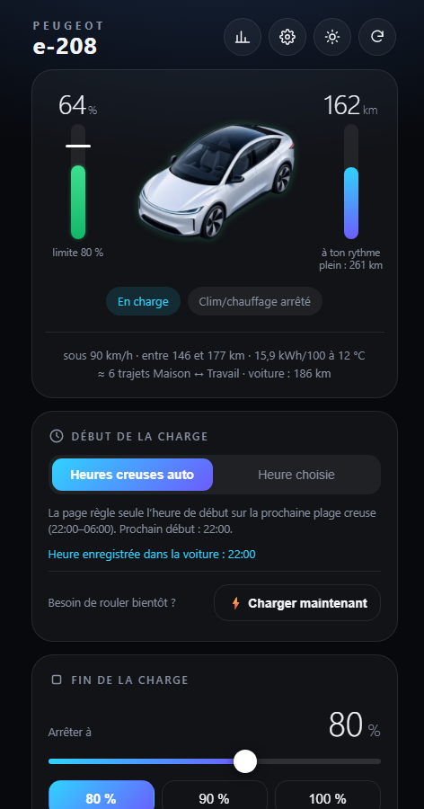
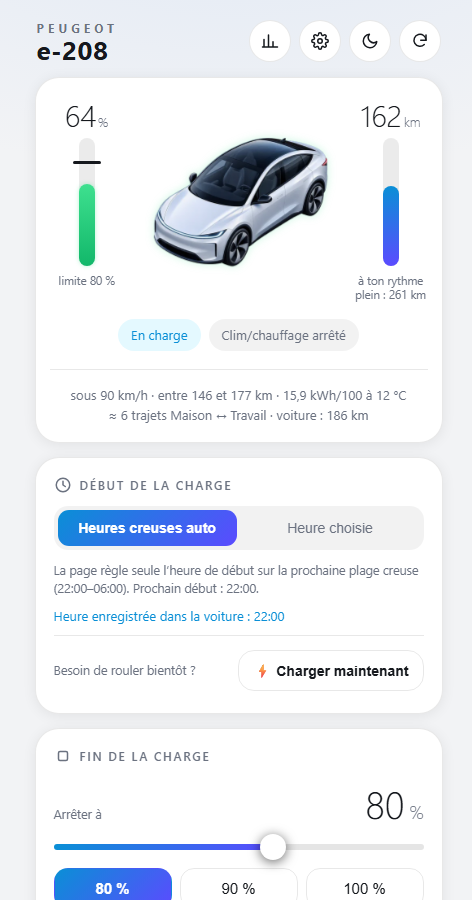
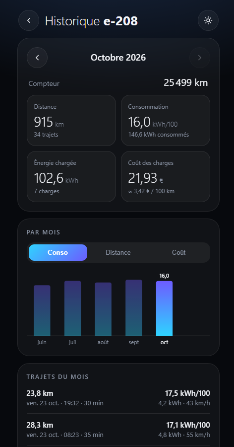
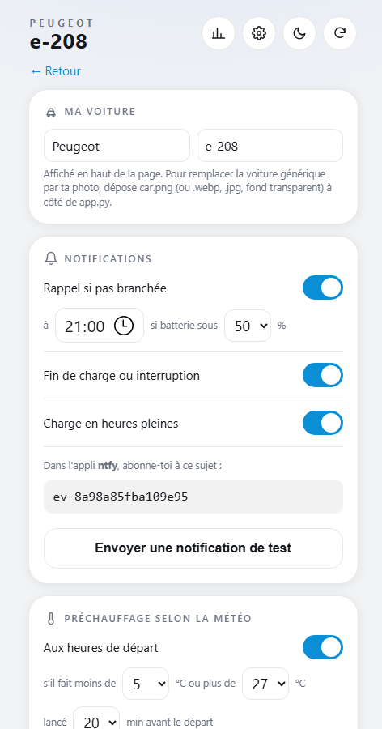

# stellantis-ev-companion

Page web compagnon de [psa_car_controller](https://github.com/flobz/psa_car_controller) pour les voitures électriques
du groupe Stellantis (Peugeot, Citroën, DS, Opel, Vauxhall…), pensée pour le téléphone.

*[English version below](#english).*

<table>
  <tr>
    <td align="center"><br><sub>Accueil (mode sombre, en charge)</sub></td>
    <td align="center"><br><sub>Accueil (mode jour)</sub></td>
    <td align="center"><br><sub>Historique</sub></td>
    <td align="center"><br><sub>Réglages</sub></td>
  </tr>
</table>

<sub>Captures réalisées avec des données fictives.</sub>

## Ce que ça fait

- **Arrêt de charge fiable à X %** (et/ou à une heure donnée). L'arrêt intégré à psa_car_controller ne se déclenche
  pas quand l'état de charge manque dans son cache (voir [Pourquoi ce projet](#pourquoi-ce-projet)) : cette page
  interroge directement l'API et arrête la charge elle-même.
- **Heures creuses automatiques** : l'heure de début de charge différée est recalée sur la prochaine plage creuse
  (plusieurs plages possibles), la charge est suspendue en fin de plage et reprend à la suivante. Une charge qui
  démarre en heures pleines est remise en attente.
- **Clim / chauffage** : démarrage immédiat, programmation par jours de la semaine, et **préconditionnement selon la
  météo** (Open-Meteo) : il n'est lancé avant un départ que s'il fait froid ou chaud.
- **Historique** : trajets, consommation, charges et **coût** (tarifs heures pleines / creuses de psa_car_controller),
  graphique par mois, compteur kilométrique.
- **Autonomie « à ton rythme »** : estimée à partir de la consommation réelle des derniers trajets, corrigée par la
  température.
- **Notifications** sur le téléphone avec [ntfy](https://ntfy.sh) : oubli de branchement, fin de charge, charge
  interrompue, charge en heures pleines, préchauffage, bilan mensuel.
- Mode **jour / nuit**, interface en français.

## Prérequis

- psa_car_controller qui fonctionne (Docker ou pip), avec les commandes à distance activées (code SMS + PIN).
- Python 3.9 ou plus récent. **Aucune dépendance** : uniquement la bibliothèque standard.
- Recommandé : [Tailscale](https://tailscale.com) pour accéder à la page depuis le téléphone.

## Installation (Raspberry Pi / Linux)

```bash
sudo mkdir -p /opt/stellantis-ev-companion
sudo cp app.py config.example.json /opt/stellantis-ev-companion/
cd /opt/stellantis-ev-companion
sudo cp config.example.json config.json
sudo nano config.json            # VIN, heures creuses, départs...
sudo cp deploy/stellantis-ev-companion.service /etc/systemd/system/
sudo systemctl daemon-reload && sudo systemctl enable --now stellantis-ev-companion
```

La page est alors sur `http://<adresse-du-serveur>:8080`. Dans **⚙️ Réglages**, abonne-toi au sujet ntfy affiché
dans l'appli ntfy, puis active les fonctions voulues.

Une voiture générique (vue 3/4) est affichée en haut de la page. Pour mettre la photo de ta voiture, dépose
`car.png` (ou `.webp`, `.jpg`, fond transparent) à côté de `app.py`. N'utilise pas d'images protégées si tu publies
ton installation.

## Accès depuis le téléphone, sans ouvrir de port : Tailscale

La page pilote la voiture et n'a pas de mot de passe : elle ne doit **jamais** être accessible depuis Internet
(pas de redirection de port sur la box). [Tailscale](https://tailscale.com) crée un réseau privé chiffré entre tes
appareils : le téléphone voit le serveur comme s'il était à la maison, où que tu sois.

1. Crée un compte sur tailscale.com (connexion Google, Microsoft, Apple ou GitHub) et **active la double
   authentification** sur ce compte : c'est elle qui protège l'accès.
2. Sur le serveur :
   ```bash
   curl -fsSL https://tailscale.com/install.sh | sh
   sudo tailscale up
   ```
   Ouvre le lien affiché et connecte-toi avec le même compte.
3. Dans la console Tailscale (*Machines*), menu « … » du serveur → **Disable key expiry**, sinon il se déconnecte au
   bout de 180 jours.
4. Sur le téléphone, installe l'appli **Tailscale**, connecte-toi avec le même compte et active-la.
5. Ouvre `http://<nom-du-serveur>:8080` (ou `http://100.x.y.z:8080`, adresse donnée par `tailscale ip -4`) et
   ajoute la page à l'écran d'accueil.

Bonus : avec Tailscale, tu peux aussi te connecter en SSH au serveur depuis n'importe où et fermer tout port ouvert
sur ta box.

## Notifications sur le téléphone : ntfy

La page envoie ses notifications avec [ntfy](https://ntfy.sh), une appli gratuite (Android et iPhone) qui ne demande
pas de compte.

1. Installe l'appli **ntfy** sur le téléphone.
2. Dans la page, ouvre **⚙️ Réglages** : la carte *Notifications* affiche ton **sujet**, tiré au hasard au premier
   lancement (par exemple `ev-8a98a85fba109e95`).
3. Dans ntfy, appuie sur **+**, colle ce sujet, garde le serveur `ntfy.sh` et valide.
4. Appuie sur **Envoyer une notification de test** dans la page : elle doit arriver en quelques secondes.
5. Choisis les alertes voulues (oubli de branchement, fin de charge, charge en heures pleines…).

Les messages passent par le service public ntfy.sh : quiconque connaît le sujet peut les lire. Ils ne contiennent ni
position ni identifiants, seulement niveaux de batterie, coûts et températures. Ne partage pas ton sujet. Pour un
contrôle total, tu peux héberger ton propre serveur ntfy et changer `NTFY_SERVER` dans `app.py`.

## Réglages (`config.json`)

| Clé | Rôle | Exemple |
|---|---|---|
| `vin` | VIN de la voiture (obligatoire) | `"VR3XXXXXXXXXXXXXX"` |
| `psacc_url` | Adresse de psa_car_controller | `"http://127.0.0.1:5000"` |
| `port` | Port de la page | `8080` |
| `brand`, `model` | Nom affiché (modifiable aussi dans Réglages) | `"Peugeot"`, `"e-208"` |
| `battery_kwh` | Capacité utile de la batterie | `46` |
| `offpeak` | Plages d'heures creuses `[début, fin]` | `[["22:00", "06:00"]]` |
| `departures` | Départs habituels pour le préconditionnement : jours (0 = lundi), heure, lieu | voir l'exemple |
| `weather` | Lieu de référence pour la température (sinon le premier départ) | `{"place": "Lyon", "lat": 45.76, "lon": 4.84}` |
| `commute` | Trajet type affiché avec l'autonomie (facultatif) | `{"label": "Maison ↔ Travail", "km": 25}` |

Les réglages faits dans la page (limites, notifications, programmations…) sont enregistrés dans le dossier
d'état (`StateDirectory` du service systemd, sinon à côté de `app.py`).

## Pourquoi ce projet

Sur au moins une Peugeot e-208 (2021), le journal de psa_car_controller affiche en continu
`charging status not available from api` : l'état de charge n'est pas présent dans les données en cache, alors qu'une
requête fraîche (`/get_vehicleinfo/<vin>?from_cache=0`) le renvoie bien. Conséquence : le contrôle de charge
(`percentage_threshold`, `stop_hour`) ne voit jamais la voiture « en charge » et **ne l'arrête pas** ; l'historique des
charges n'a pas de fin ni de coût.

Cette page contourne le problème :
- elle interroge l'API avec `from_cache=0` toutes les 5 minutes (2 minutes pendant une charge) ;
- pour arrêter une charge, elle programme la charge différée à une heure **déjà passée** (`/charge_hour`) :
  la voiture se met en attente jusqu'au lendemain (même technique que le « postpone » de psa_car_controller) ;
- elle enregistre elle-même début, fin, pourcentages et coût de chaque charge.

Autres constats : sur ce véhicule, la voiture repasse en **charge immédiate à chaque branchement** ; renvoyer la
commande de charge différée une fois branchée la remet bien en attente (LED bleue). La position GPS n'est pas
fournie par l'API utilisée (coordonnées nulles), alors que l'appli officielle l'affiche.

## Sécurité

- **N'expose jamais la page ni psa_car_controller sur Internet** : elles n'ont pas de mot de passe et pilotent la
  voiture. Utilise Tailscale (ou un VPN) ; ne redirige aucun port sur ta box.
- Le sujet ntfy est tiré au hasard ; quiconque le connaît peut lire les notifications (pas de position ni
  d'identifiants dedans).

## Limites

- Testé sur une Peugeot e-208 (2021) ; les autres modèles Stellantis compatibles avec psa_car_controller devraient
  fonctionner, sans garantie.
- Interface en français uniquement.
- Projet personnel, sans lien avec Stellantis. Les noms de marques appartiennent à leurs propriétaires.

## Licence

GPL-3.0-or-later, comme psa_car_controller.

---

## English

A phone-friendly companion web page for [psa_car_controller](https://github.com/flobz/psa_car_controller), for
Stellantis electric cars (Peugeot, Citroën, DS, Opel, Vauxhall…).

The screenshots at the top of this page were made with fictional data. The interface is currently in French only
(see [Limitations](#limitations)).

### What it does

- **Reliable charge stop at X %** (and/or at a given time). psa_car_controller's built-in stop does not fire when the
  charging state is missing from its cache (see [Why this project](#why-this-project)): this page queries the API
  directly and stops the charge itself.
- **Automatic off-peak charging**: the delayed-charge start time is moved to the next off-peak window (several windows
  supported), charging is paused at the end of a window and resumes at the next one. A charge that starts during peak
  hours is put back on hold.
- **Air conditioning / heating**: start now, weekday schedule, and **weather-based preconditioning**
  ([Open-Meteo](https://open-meteo.com)): before a departure, it only starts if it is cold or hot outside.
- **History**: trips, consumption, charges and their **cost** (peak / off-peak prices from psa_car_controller),
  monthly chart, odometer.
- **"At your pace" range**: estimated from the real consumption of your recent trips, corrected for temperature.
- **Phone notifications** with [ntfy](https://ntfy.sh): car not plugged in, charge finished, charge interrupted, charge
  started during peak hours, preconditioning, monthly report.
- **Day / night** theme.

### Requirements

- A working psa_car_controller (Docker or pip), with remote commands enabled (SMS code + PIN).
- Python 3.9 or newer. **No dependencies**: standard library only.
- Recommended: [Tailscale](https://tailscale.com) to reach the page from your phone.

### Installation (Raspberry Pi / Linux)

```bash
sudo mkdir -p /opt/stellantis-ev-companion
sudo cp app.py config.example.json /opt/stellantis-ev-companion/
cd /opt/stellantis-ev-companion
sudo cp config.example.json config.json
sudo nano config.json            # VIN, off-peak windows, departures...
sudo cp deploy/stellantis-ev-companion.service /etc/systemd/system/
sudo systemctl daemon-reload && sudo systemctl enable --now stellantis-ev-companion
```

The page is then available at `http://<server-address>:8080`. In **⚙️ Réglages** (settings), subscribe to the ntfy
topic shown there in the ntfy app, then enable the features you want.

A generic car (3/4 view) is shown at the top of the page. To use a photo of your own car, put `car.png` (or `.webp`,
`.jpg`, with a transparent background) next to `app.py`. Do not use copyrighted images if you publish your setup.

### Phone access without opening a port: Tailscale

The page controls the car and has no password: it must **never** be reachable from the Internet (no port forwarding
on your router). [Tailscale](https://tailscale.com) creates an encrypted private network between your devices: your
phone sees the server as if it were at home, wherever you are.

1. Create an account on tailscale.com (sign in with Google, Microsoft, Apple or GitHub) and **turn on two-factor
   authentication** for that account: it is what protects access.
2. On the server:
   ```bash
   curl -fsSL https://tailscale.com/install.sh | sh
   sudo tailscale up
   ```
   Open the link that is printed and sign in with the same account.
3. In the Tailscale admin console (*Machines*), open the server's "…" menu → **Disable key expiry**, otherwise it gets
   disconnected after 180 days.
4. On the phone, install the **Tailscale** app, sign in with the same account and turn it on.
5. Open `http://<server-name>:8080` (or `http://100.x.y.z:8080`, the address given by `tailscale ip -4`) and add the
   page to your home screen.

Bonus: with Tailscale you can also SSH into the server from anywhere, and close every port open on your router.

### Phone notifications: ntfy

The page sends its notifications with [ntfy](https://ntfy.sh), a free app (Android and iPhone) that needs no account.

1. Install the **ntfy** app on your phone.
2. In the page, open **⚙️ Réglages**: the *Notifications* card shows your **topic**, picked at random on first start
   (for example `ev-8a98a85fba109e95`).
3. In ntfy, tap **+**, paste the topic, keep the `ntfy.sh` server and confirm.
4. Tap **Envoyer une notification de test** (send a test notification) in the page: it should arrive within seconds.
5. Choose the alerts you want (car not plugged in, charge finished, charging during peak hours…).

Messages go through the public ntfy.sh service: anyone who knows the topic can read them. They contain no location
and no credentials, only battery levels, costs and temperatures. Do not share your topic. For full control, you can
host your own ntfy server and change `NTFY_SERVER` in `app.py`.

### Settings (`config.json`)

| Key | Purpose | Example |
|---|---|---|
| `vin` | Vehicle VIN (required) | `"VR3XXXXXXXXXXXXXX"` |
| `psacc_url` | psa_car_controller address | `"http://127.0.0.1:5000"` |
| `port` | Page port | `8080` |
| `brand`, `model` | Displayed name (can also be changed in the settings) | `"Peugeot"`, `"e-208"` |
| `battery_kwh` | Usable battery capacity | `46` |
| `offpeak` | Off-peak windows `[start, end]` | `[["22:00", "06:00"]]` |
| `departures` | Usual departures for preconditioning: days (0 = Monday), time, place | see the example |
| `weather` | Reference place for the temperature (otherwise the first departure) | `{"place": "Lyon", "lat": 45.76, "lon": 4.84}` |
| `commute` | Typical trip shown with the range (optional) | `{"label": "Home ↔ Work", "km": 25}` |

Settings changed in the page (limits, notifications, schedules…) are saved in the state directory (the systemd
service's `StateDirectory`, otherwise next to `app.py`).

### Why this project

On at least one Peugeot e-208 (2021), the psa_car_controller log keeps showing
`charging status not available from api`: the charging state is missing from the cached data, while a fresh request
(`/get_vehicleinfo/<vin>?from_cache=0`) does return it. As a result, charge control (`percentage_threshold`,
`stop_hour`) never sees the car as "charging" and **never stops it**; the charge history has no end and no cost.

This page works around the problem:
- it queries the API with `from_cache=0` every 5 minutes (every 2 minutes while charging);
- to stop a charge, it sets the delayed-charge time to a time **already passed** (`/charge_hour`): the car then waits
  until the next day (the same technique as psa_car_controller's "postpone");
- it records the start, end, percentages and cost of each charge itself.

Other findings: on this car, charging switches back to **immediate charging every time it is plugged in**; sending
the delayed-charge command again once plugged in puts it back on hold (blue LED). The GPS position is not provided by
the API used (null coordinates), even though the official app shows it.

### Security

- **Never expose the page or psa_car_controller to the Internet**: they have no password and control the car. Use
  Tailscale (or a VPN); do not forward any port on your router.
- The ntfy topic is random; anyone who knows it can read the notifications (they contain no location or credentials).

### Limitations

- Tested on a Peugeot e-208 (2021); other Stellantis models supported by psa_car_controller should work, with no
  guarantee.
- French interface only for now.
- Personal project, not affiliated with Stellantis. Brand names belong to their owners.

### License

GPL-3.0-or-later, like psa_car_controller.
